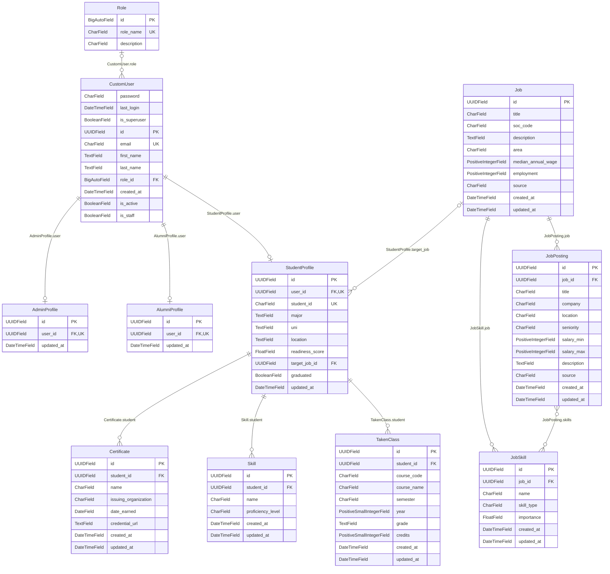

# Database schema

## Relationships

Generated from the models by `make schema-docs`. Read each FK row as
"**`From.field`** points at **`To`**". In the diagram, the line is labeled
with the FK field and the table on the `o{` ("many") end holds the FK column.

Crow's-foot symbols: `||` exactly one, `o|` zero or one, `o{` zero or many.
`PK` primary key, `FK` foreign key, `UK` unique.

<!-- schema:start -->

### Foreign keys

| From (holds the FK column) | Field | Points at | Type | If the target is deleted |
|---|---|---|---|---|
| `AdminProfile` | `user` | `CustomUser` | one-to-one | row deleted |
| `AlumniProfile` | `user` | `CustomUser` | one-to-one | row deleted |
| `Certificate` | `student` | `StudentProfile` | many Certificate to one StudentProfile | row deleted |
| `CustomUser` | `role` | `Role` | many CustomUser to one Role (optional) | FK set to NULL |
| `JobPosting` | `job` | `Job` | many JobPosting to one Job | row deleted |
| `JobPosting` | `skills` | `JobSkill` | many-to-many | link row removed |
| `JobSkill` | `job` | `Job` | many JobSkill to one Job | row deleted |
| `Skill` | `student` | `StudentProfile` | many Skill to one StudentProfile | row deleted |
| `StudentProfile` | `target_job` | `Job` | many StudentProfile to one Job (optional) | FK set to NULL |
| `StudentProfile` | `user` | `CustomUser` | one-to-one | row deleted |
| `TakenClass` | `student` | `StudentProfile` | many TakenClass to one StudentProfile | row deleted |

### Diagram



<!-- schema:end -->

## Regenerating

After changing any model, run:

```sh
make schema-docs
```

`uv run manage.py schema_docs --check` fails if they are out of date.
