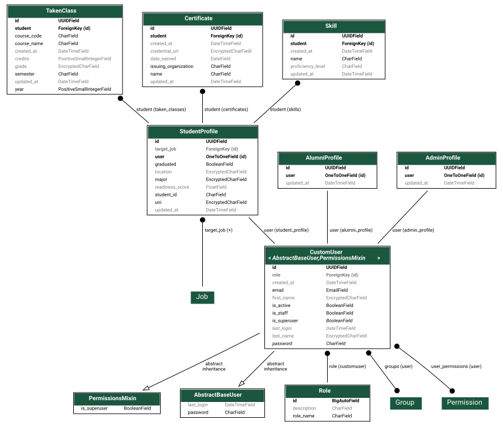

# Database schema

Generated straight from `accounts/models.py` via django-extensions'
`graph_models` (Graphviz) - not hand-maintained, so it can't drift from the
actual models.



## Regenerating

After changing `accounts/models.py`, run:

```sh
make schema-diagram
```

This builds `backend/Dockerfile.dev` (the same dev image `docker-compose.dev.yml`
uses, plus Graphviz) and writes `backend/docs/schema.svg` in place. Commit the
updated SVG alongside your model changes.
